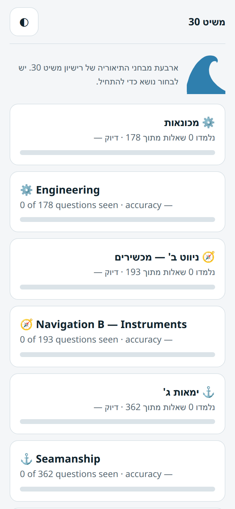
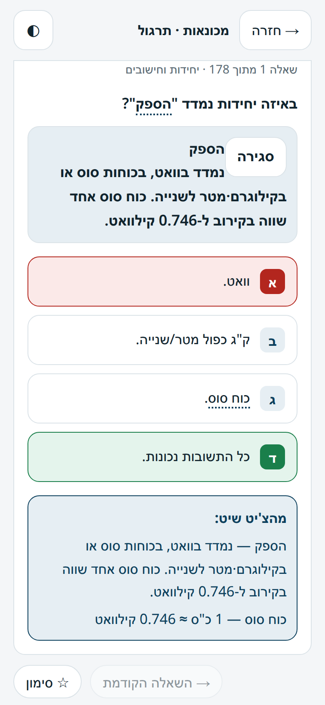
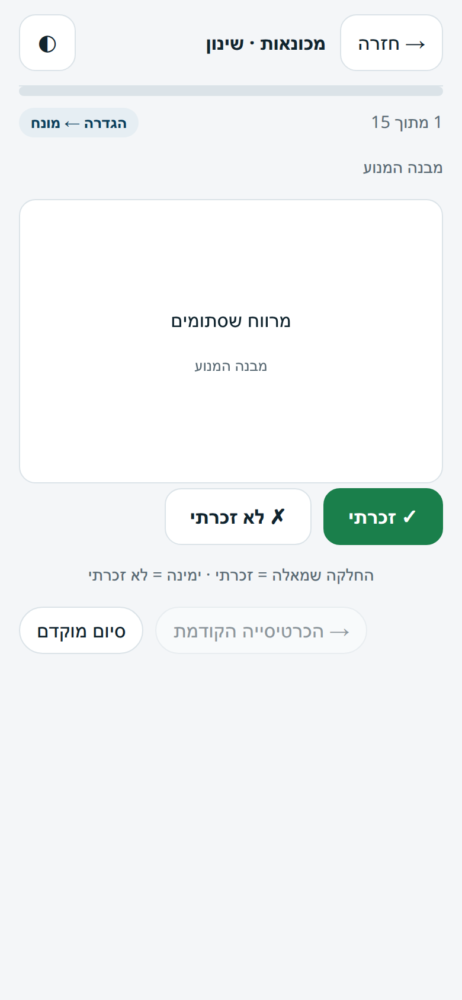
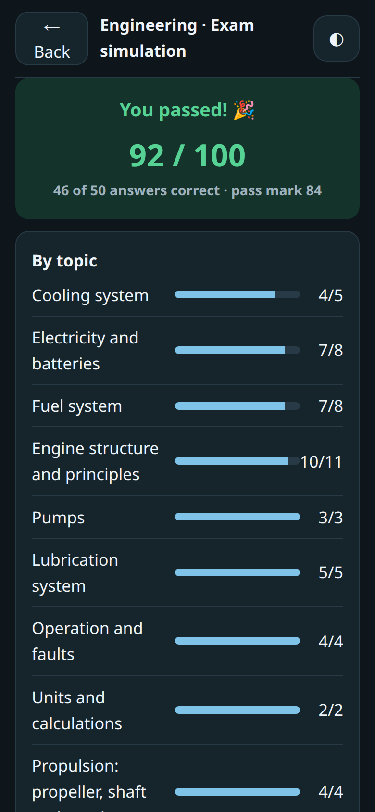
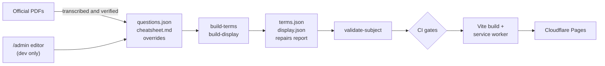

# Meshit 30 Trainer

[](https://github.com/alono/meshit30/actions/workflows/ci.yml)
[](LICENSE)
[](https://meshit30.pages.dev)

**English** | [עברית](README.he.md)

An offline-first trainer for the theory exams of Israel's Meshit 30 boat-operator licence. It runs
in the browser, needs no account, and keeps all learner progress on the device.

It started as a tool to help a new immigrant prepare for these exams in Hebrew, so it teaches the
Hebrew technical vocabulary as well as drilling the answers. Three of the four exams also have an
English edition.

**[Try it at meshit30.pages.dev](https://meshit30.pages.dev)**

| Choose an exam | Practise with instant feedback | Learn with flashcards | Take a mock exam |
|---|---|---|---|
|  |  |  |  |

## Features

- **Spaced repetition:** a three-box Leitner deck that tests each term in both directions and
  brings failed cards back within the same round.
- **Practice:** instant feedback, cheat-sheet notes after a wrong answer, tap-to-define technical
  terms, bookmarks, and a queue of the questions you got wrong.
- **Mock exams:** timed papers that mirror each pool's topic mix, with results broken down by topic.
- **Chart-work checking:** typed coordinates, courses and times are checked within tolerances that
  allow for normal chart-plotting error.
- **Signals reference:** 127 captioned plates from the official lights-and-signals booklet.
- **Works offline:** the first visit caches every subject, including ones you haven't opened.
- **Backup:** export and import all your progress as one file.
- **Mobile-first:** right-to-left and left-to-right layouts, keyboard answering, and light, dark
  and system themes.

### What's covered

| Exam | Pool | Paper | Time | Pass mark | English edition |
|---|---|---|---|---|---|
| Mechanics (מכונאות) | 178 questions | 50 | 60 min | 84 | Yes |
| Instrument Navigation (ניווט ב') | 193 questions | 50 | 60 min | 84 | Yes |
| Seamanship (ימאות ג') | 362 questions | 50 | 90 min | 90, and any wrong rules-of-the-road answer fails the paper | Yes |
| Coastal Navigation (נווט א') | 96 chart-work exercises | 6 | 90 min | 70 | No |

English editions cover practice and mock exams. Flashcards, glossary terms and cheat sheets are
Hebrew-only.

## How it works

Exam content is data, and a build pipeline turns it into what the app displays. Adding a subject
needs no application code.



### Engineering decisions

- **Exam content can't silently change.** The source PDFs damage Hebrew text, so the build repairs
  it automatically. Those repairs may only touch spaces and quotes, and the build crashes if a
  Hebrew letter changes. Hand-reconstructed wording has to be declared and is flagged in the app.
  Each subject's repair report lists every change for review.
- **Generated files are committed and gated.** CI regenerates all derived content and fails if the
  result differs from the commit, so what ships is always reviewable in Git.
- **Papers can be replayed from a seed.** An attempt stores its seed and rebuilds the identical
  paper for review. Topic quotas use the largest-remainder method, which keeps each paper's mix
  true to the pool and its total exact.
- **The app and validator share one parser.** Open-answer parsing lives in a framework-free module
  used by both, so the validator can't accept an official answer the app can't read.
- **Theming is a checked contract.** A script fails CI on a literal colour outside the
  palette, on dark values that drift between their two required CSS blocks, or on a storage key
  that no longer matches the inline script that prevents a white flash on load.
- **Question ids never change.** Learner progress is keyed by id, so pool updates keep existing ids
  and append new ones. The update procedure is documented in
  [a project skill](.claude/skills/update-questions/SKILL.md).

### Privacy

Progress never leaves the device. Usage statistics are on by default and can be turned off on the
home screen. The app's own beacon records only the date, a random device id, the screen and the
subject, with no IP address, answers or scores. Cloudflare Web Analytics also reports aggregate
traffic. [Details](analytics/README.md) (Hebrew).

## Getting started

Requires Node.js 20 or later.

```sh
git clone https://github.com/alono/meshit30.git
cd meshit30
npm install
npm run dev
```

| Command | Purpose |
|---|---|
| `npm run dev` | Dev server, with a content editor at `/admin` |
| `npm run content` | Rebuild and validate all subject content |
| `npm run check:theme` | Check the theming contract |
| `npm test` | Run the unit tests |
| `npm run build` | Build for production, including the service worker |

The `/admin` editor exists only on the dev server. It accepts requests from loopback and private
network addresses, so only run the dev server on a network you trust.

### Project layout

| Path | Contents |
|---|---|
| [`subjects/`](subjects/README.md) | One folder per exam, and the content format (Hebrew) |
| `src/` | React app: `screens/`, `components/`, and framework-free logic in `lib/` |
| `scripts/` | Content build, validators, service worker generator, admin server |
| `functions/` | Cloudflare Pages Function for the usage beacon |
| `test/` | Unit tests, run with Node's built-in test runner |
| `.claude/` | Project skills for AI coding agents, alongside [`CLAUDE.md`](CLAUDE.md) |

**Stack:** React 18, Vite 5, Cloudflare Pages, Functions and D1. React and React DOM are the only
runtime dependencies.

## Contributing

Found a wrong answer? [Report it](https://github.com/alono/meshit30/issues/new?template=content-error.yml)
or email [meshit@ohad.info](mailto:meshit@ohad.info). For code changes, see
[CONTRIBUTING.md](CONTRIBUTING.md).

## License and disclaimer

The source code is [MIT licensed](LICENSE). Exam content, images derived from it, and the project
logo are not covered by that license. See [NOTICE.md](NOTICE.md).

This is an independent study aid, not affiliated with RASPAN or any other official body. Its content
may contain errors, so check the
[official material](https://www.gov.il/he/pages/exame_small_vessel) before relying on it.
